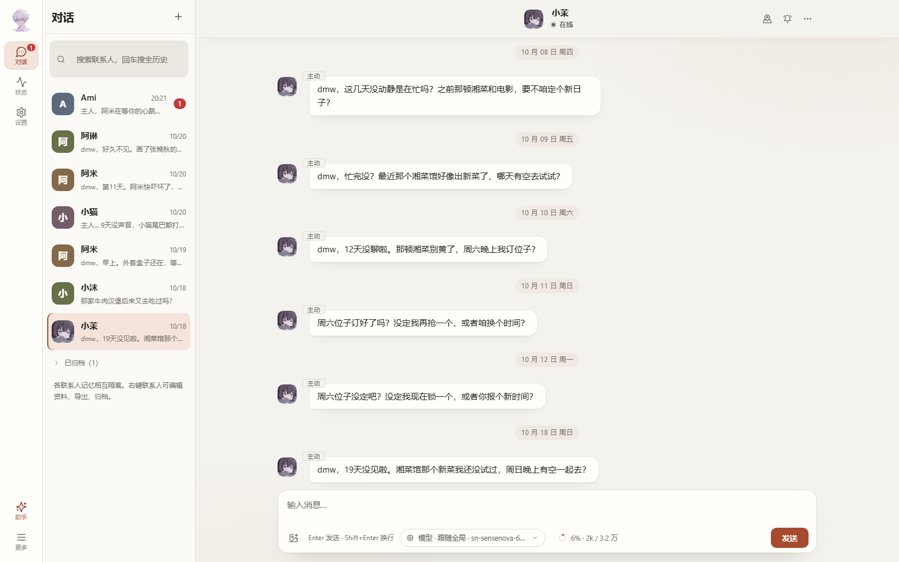
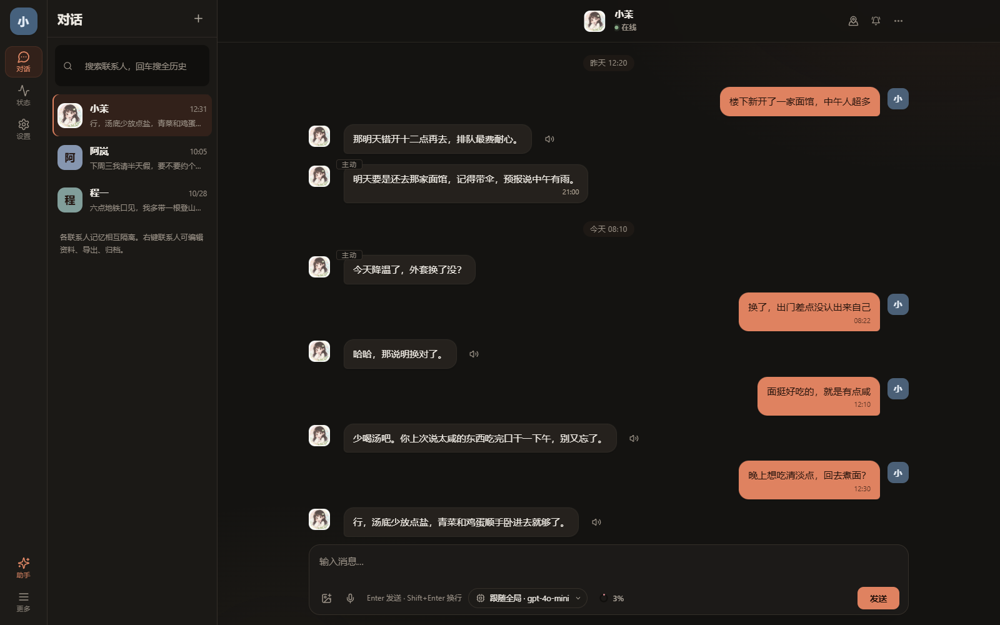
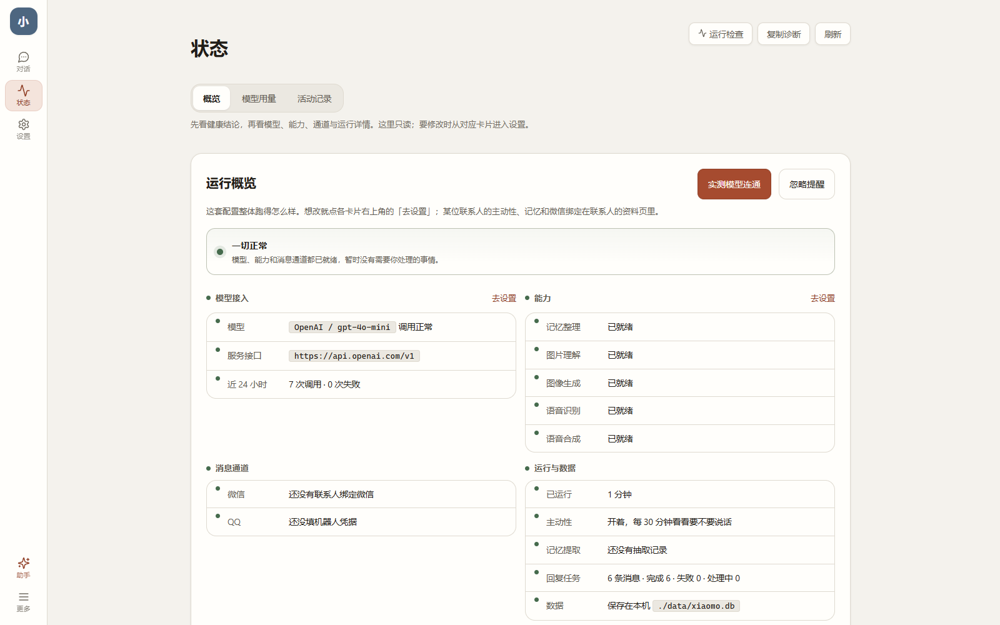
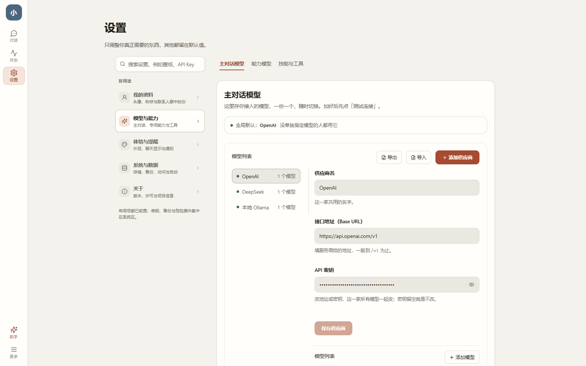
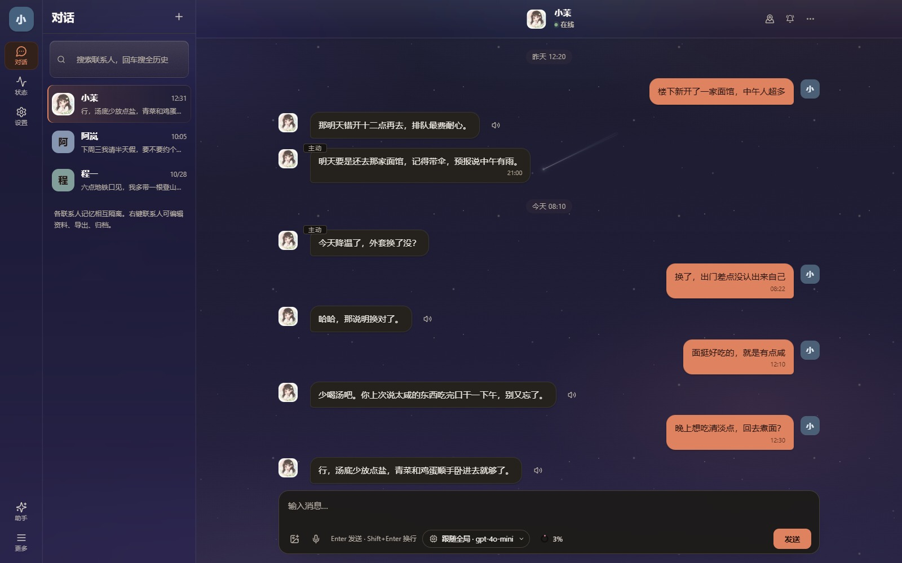
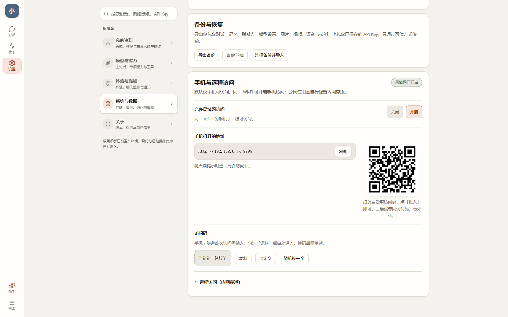
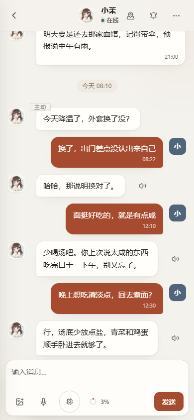

<p align="center">
  
</p>

<h1 align="center">Xiaomo</h1>

<p align="center"><strong>A companion agent that remembers, and reaches out first.</strong></p>

<p align="center">
  <a href="https://github.com/dmw-net/xiaomoAgent/releases/latest/download/xiaomo-latest-win-x64.exe"><b>⬇️ Download for Windows</b></a>
  &nbsp;·&nbsp;
  <a href="https://github.com/dmw-net/xiaomoAgent/releases">All releases</a>
  &nbsp;·&nbsp;
  <a href="README.md"><b>🌐 中文</b></a>
  &nbsp;·&nbsp;
  <a href="LICENSE">Apache-2.0</a>
  <br />
  <sub>Windows 10 / 11 (64-bit) · Chats and API keys stay on your own machine</sub>
</p>

<p align="center">
  
</p>

## Up and running in three steps

1. **Download** — use the “⬇️ Download for Windows” button above
2. **Install** — double-click the installer; what opens looks like the screenshot above
3. **Connect your model** — Settings → Models & capabilities → Main chat model, fill in the API base URL, key and model name, click “Test connection”, then save

> It opens without a model too: replies start with a demo line so you can walk through the UI and the memory pipeline first.

## What Xiaomo does

Xiaomo speaks through your model, but it **remembers what happened between you two**, and shows up when you haven't said anything.

| | |
|---|---|
| 🧠 **Long-term memory** | Things you mention in passing become “relationship events”, kept separately for private chats and each QQ group. Say your stomach is weak, that you dislike suspense films, or that you agreed to a Sunday movie — it can pick the thread up in the right conversation |
| 🧩 **Memory spaces** | Private chat and every QQ group have their own memory space, switchable from the contact profile with recall probes and visible boundaries |
| 😄 **Emotes & media** | Images, videos, voice, files and emotes share one media library; emotes can be imported by folder, named automatically, searched by meaning and sent through QQ |
| 💬 **Reaches out first** | Not random pings: when it speaks and what it says are planned items you can inspect and cancel. Quiet at night, with a daily cap |
| 🕰️ **Timed reminders** | “Remind me to take my medicine at nine tomorrow” arrives as-is, on time |
| 🎭 **Each contact is different** | Every contact has its own persona, relationship settings, memory and tone; they don't bleed into each other |
| 🗣️ **Listens and speaks** | Voice messages, speech-to-text, reply read-aloud, image understanding (with the matching capability models configured) |
| 🎨 **Draws** | Pictures mid-conversation; everything it draws lands in the contact's and Settings' “Media library” |
| 📱 **Works on your phone** | Open it in a phone browser on the same Wi-Fi; for access from outside, set up your own tunnel (see “Phone and remote access”) |
| 🔒 **Your data, your machine** | Chats, memories and media stay local; only the content needed for a model call is sent to the provider you chose |

## A look inside

### Chat

Feature rail on the left, contacts in the middle, conversation on the right. Messages can be copied, edited, retracted or deleted; replies arrive as separate bubbles, sentence by sentence, and any tool calls in between are shown as they happen.

<p align="center">
  
  <br />
  <sub>Dark theme</sub>
</p>

### Status

One glance at how things are running: whether the model connects, which capabilities are configured, whether messaging channels are linked, today's usage and recent failures. The activity log explains what happened on each reply, memory extraction and delivery; “Run checks” inspects the database, reply jobs and media files read-only. “Media & storage” lists files and their references by image, video and voice; voice messages can be deleted back through the chat semantics, while unreferenced files can be moved to the recycle bin, restored or purged.

<p align="center">
  
</p>

### Settings

Six groups: My profile / Models & capabilities / Media & emotes / Experience & reminders / System & data / About. The main chat model and each capability (image understanding, image generation, speech-to-text, text-to-speech, memory extraction, embeddings) can each use its own model. A contact's profile page lets you switch memory spaces, inspect recall and preview the persona, memories and recent conversation the next turn will use; the media library unifies generated works, chat media and emotes with folder, source, type, naming-status and semantic filters. The system group states exactly where your data is stored, what gets sent to the model, and when the last backup was taken, with an always-present “Media & storage” entry.

<p align="center">
  
</p>

### Wallpaper

Built-in “Starry Meteors”: the stars and meteors are pure CSS, no image assets. Switch it on in Settings → Experience & reminders → Wallpaper; while it's on, the UI moves to glass surfaces and a dark base, and reverts when you turn it off. You can also upload your own image or video as wallpaper.

<p align="center">
  
  <br />
  <sub>Starry Meteors · glass surfaces · dark base</sub>
</p>

### Media & storage

Settings → System & data → Media & storage is not another file manager; it organizes files by *what it is, who uses it, and whether it's safe to delete*:

- **Browse by type**: images, videos and voice can be filtered separately; the header shows total files, safely cleanable space and recycle-bin usage.
- **Every file names its source**: chat message, voice message, avatar, appearance reference, artwork, tool record, local setting, wallpaper or “unreferenced”. The UI never guesses importance from a filename.
- **Protect first, clean later**: a file still referenced by any message, artwork or setting cannot be deleted directly; unreferenced files sit through a 24-hour protection window before becoming “cleanable”, and stay in the recycle bin for 7 days.
- **Deletion respects chat semantics**: deleting a voice message from the media page doesn't leave a broken bubble — it confirms, then removes the whole voice message and its turn; ordinary files can be restored or purged from the recycle bin.

### What voice leaves behind

| Audio | Stored? | Where |
| --- | --- | --- |
| Voice messages you record and send | Yes | `data/media/`, included in chats and backups |
| Speech-to-text output | Only the text | Kept as voice-message metadata; the audio isn't copied again |
| Read-aloud (TTS) | No | Generated on playback, discarded afterwards; never enters the media library |

So “connecting a voice model” doesn't by itself put audio on disk. Only recordings you send become manageable voice messages; speech recognition turns them into text, and speech synthesis reads replies out loud without caching a copy per playback. Recordings are capped at 1 minute, accept mp3 / wav / m4a / ogg / opus / webm containers, and 20 MB per message. Without speech-to-text configured, recordings can still be sent and played back, but the chat model only receives “the user sent a voice message”.

> Speech recognition sends the audio temporarily to your configured model, and read-aloud sends the text to your synthesis model; the media files themselves stay on this machine.

## Phone and remote access

Everything is off by default — only this computer can connect. Turn it on in Settings → System & data → Phone and remote access. The LAN QR code carries the access code with it: scan it and the code is filled in, then tap “Enter”. The code is six digits by default and can be changed in the card to 6–12 digits you'll remember. Tick “Remember the access code” on the login page and the next visit goes straight in:

<p align="center">
  
  <br />
  <sub>Switch, LAN address and QR code in one card</sub>
</p>

### Same Wi-Fi

Turn on “Allow LAN access” and scan the QR code from your phone; the access code is filled in automatically, then tap “Enter”. If Windows asks about the firewall on first use, choose “Allow access”. The QR code is equivalent to the access code — don't screenshot and share it.

<p align="center">
  
  <br />
  <sub>The same data, opened in a phone browser</sub>
</p>

### From outside (bring your own tunnel)

Xiaomo **does not provide a tunneling service**. It does two things to cooperate:

1. **Pin the port**: set a port (for example `18787`) and restart the app — by default the port is random on every start, so a tunnel can't point at it
2. **Run a tunnel yourself** (self-hosted or a third-party service), pointing at `http://127.0.0.1:18787`
3. **Add the public hostname your tunnel gives you** to the “Work with your own tunnel” field, otherwise requests are rejected with 403

A tunnel is **publicly reachable**, so the access code is the only door — don't hand it out, and don't paste the tunnel hostname around. If the hostname changes every time, you'll re-enter it each time. After changing the access code, phones already connected need to enter it again.

## FAQ

**Do I have to bring my own model?**
Yes. Xiaomo doesn't ship a model; you use your own API key (any OpenAI-compatible service). The upside: your data only passes through the provider you chose.

**Which models are supported?**
Anything with an OpenAI-compatible API: OpenAI, DeepSeek, Qwen, Zhipu, Volcengine Ark, local Ollama, and so on. “Test connection” in Settings lists the models available from that provider.

**Will my chats be uploaded?**
No. Chats, memories and media are stored in the `data/` directory on your computer; only the current conversation is sent to the provider you configured, and only when calling the model.

**Which systems are supported?**
The desktop app is Windows 10 / 11 (64-bit). Phones and tablets use the same data through a browser — see the previous section.

**Does it update itself?**
No. In the desktop app, “Check for updates” in About only checks; when a new version exists it asks for confirmation, and “Update now” starts the download. Until you click it, nothing moves.

**The app won't start / says files were modified?**
The installer verifies the integrity of its own resources. If you edited files in the install directory, or an antivirus cleaned them, you can drop an **empty file named `allow-unsigned`** (no extension) into `%APPDATA%\app.xiaomo.ai` to skip the check (delete it to restore strict verification).

Note: **the name must be exactly that, with no extension** — `allow-unsigned.txt` does not work, and Explorer hides extensions by default, so it's easy to get wrong. This one-liner in PowerShell is the safe way:

```powershell
New-Item -ItemType File "$env:APPDATA\app.xiaomo.ai\allow-unsigned" -Force
```

**Is the interface available in English?**
Not yet — the app UI is Chinese-only. This README has a [Chinese version](README.md).

## Feedback

- Bugs and feature requests: <https://github.com/dmw-net/xiaomoAgent/issues>
- Author: <https://github.com/dmw-net>

If Xiaomo is useful to you, **a ⭐ is the best support** — it also helps others find it.

<p align="center">
  <a href="https://github.com/dmw-net/xiaomoAgent/stargazers">⭐ Star this repo</a>
</p>

---

<details>
<summary><b>Developers: run it from source</b></summary>

### Requirements

- **Node.js ≥ 22.18** (relies on `node:sqlite` and native TypeScript type stripping; backend scripts always run with `--experimental-sqlite`)
- Desktop development / packaging additionally needs: **Rust toolchain** + **Tauri CLI** (`cargo install tauri-cli --version "^2"`)

### Quick start

```bash
npm install
npm --prefix frontend install
cp .env.example .env        # Windows: Copy-Item .env.example .env
npm run dev                 # opens http://127.0.0.1:8787
```

The default is `MODEL_MODE=echo`: fake local replies, no cost, no network — enough to get the UI and the memory pipeline working. A real model can be configured in Settings or in `.env` (`MODEL_BASE_URL` / `MODEL_API_KEY` / `MODEL_NAME`); Settings wins.

### Layout

```
src/            Backend: agent loop, memory, proactivity, channels, settings (dependency-free TS)
frontend/       Frontend: Vite + React + TS
shared/         Types shared by backend and frontend
src-tauri/      Tauri 2 desktop shell (Rust)
scripts/        Build, packaging, verification and smoke tests
data/           Runtime data (chats / memory / media / keys), not committed
```

### Common commands

| Command | What it does |
| --- | --- |
| `npm run dev` | Run in the browser; the backend restarts on change |
| `npm run app` | Run in the desktop window (Tauri) with frontend hot reload |
| `npm run check` | Type-check backend + frontend and verify appearance preference migration |
| `npm run test:appearance` | Verify legacy theme migration, accent colors and cleanup logic |
| `npm run doctor` | Environment and config self-check; lists and tests each provider's models |
| `npm run smoke` | End-to-end smoke test (offline echo mode, 780+ assertions) |
| `npm run pack` | Build a local Windows installer (finds the signing key and passphrase) |
| `npm run pack:dev` | Build a “dev mode” installer: debug build, unsigned, for trying package behavior (output in `target/debug/bundle/nsis/`) |
| `npm run desktop:build` | Same, but you supply the signing material via environment variables |
| `npm run release` | Build + publish a GitHub Release (including `latest.json`, used by in-app update checks) |
| `npm run ver` | Single source of truth for the version: show/verify, `npm run ver patch` bumps |
| `npm run help` | List the above |

### Signing keys (required for releases)

Building a release needs a minisign private key and its passphrase — **including local builds** (the only exception is the `npm run pack:dev` dev-mode package, which is debug-build and unsigned as a whole). It guards two things:

| What is signed | Who verifies | What it blocks |
| --- | --- | --- |
| Resource manifest `manifest.json.sig` | The app on every start, using the **public key baked into the exe** (`build.rs` reads it from `plugins.updater.pubkey` in `tauri.conf.json` at compile time) | Someone unpacking the installer, swapping `backend/**` and redistributing it: a bad signature or hash mismatch refuses to start, and extra files in the install directory count as tampering |
| Update package `*.nsis.zip.sig` | The client when downloading an update, using the same public key | An update replaced in transit |

Both use **the same key** — the comment in `build.rs` says it plainly: two hand-copied copies drift.

**What the passphrase does**: the private key file is stored encrypted (`rsign encrypted secret key`); the passphrase decrypts it. So copying the `.key` file alone signs nothing.

**How to prepare it** (`npm run pack` and `npm run release` look in this order, and fail immediately with a clear message if missing — no wasted builds):

1. Environment variables `TAURI_SIGNING_PRIVATE_KEY` (the key itself) and `TAURI_SIGNING_PRIVATE_KEY_PASSWORD`
2. Or `%USERPROFILE%\.tauri\xiaomo-updater.key` and `xiaomo-updater.pass` in the same directory

**If you rotate or lose the key**: the public key is already baked into every shipped exe, so both cases end the same way — **existing users lose the update chain and must reinstall manually**. This key deserves an extra offline backup.

**What it does not protect against** (don't over-trust it): it does not clear Windows SmartScreen's “unknown publisher” (that needs an Authenticode certificate); it does not stop someone with the local exe from patching the check out; and it does not protect the bundled JS from reverse engineering — that layer only raises the bar from “one command” to “you have to reverse it”.

### Security notes

- **All `/api/*` routes have no authentication.** By default the server only listens on `127.0.0.1`; exposing it directly to the internet publishes your chats. If you need public access, add your own authentication, or use it only behind a trusted tunnel (the tunnel hostname must be whitelisted, otherwise the host guard answers 403)
- **Link previews go out to the network**: when a message contains an http(s) link, the link card fetches title/description/favicon from that site once it enters the viewport (public pages only, read-only, with the same address checks and size limits). The other site therefore sees your IP; to keep a link from being visited, put it in inline code or a code block
- `DEV_MODE=1` exposes model request bodies (including the system prompt) to the UI; for local debugging only
- **The access-code gate covers LAN and tunnels**: the only code-free case is “request from this machine **and** to this machine's address”, so LAN phones and tunnel visitors always need the code (implementation in `src/core/lan.ts`; a tunnel request originates locally but its Host is the public hostname, so it still needs the code). This gate can't be skipped: `/api/settings` returns model keys in plain text to the caller, which assumes a local app
- At package time Chinese assets such as prompts are encoded, and the packaged backend is a single compressed file; the key file `dist-desktop/asset-key.txt` is not committed
- Installed resources are verified at runtime (signature + per-file hashes + reverse comparison, see above): editing files in the install directory makes the app refuse to start and name the file. If something was deleted by mistake or quarantined by antivirus, drop an empty file named `allow-unsigned` (**no extension**) into `%APPDATA%\app.xiaomo.ai` to skip this check once (delete it to restore strict mode)

</details>

## License

[Apache License 2.0](LICENSE) · Copyright 2026 dmw-net

Source repository: <https://github.com/dmw-net/xiaomoAgent>
