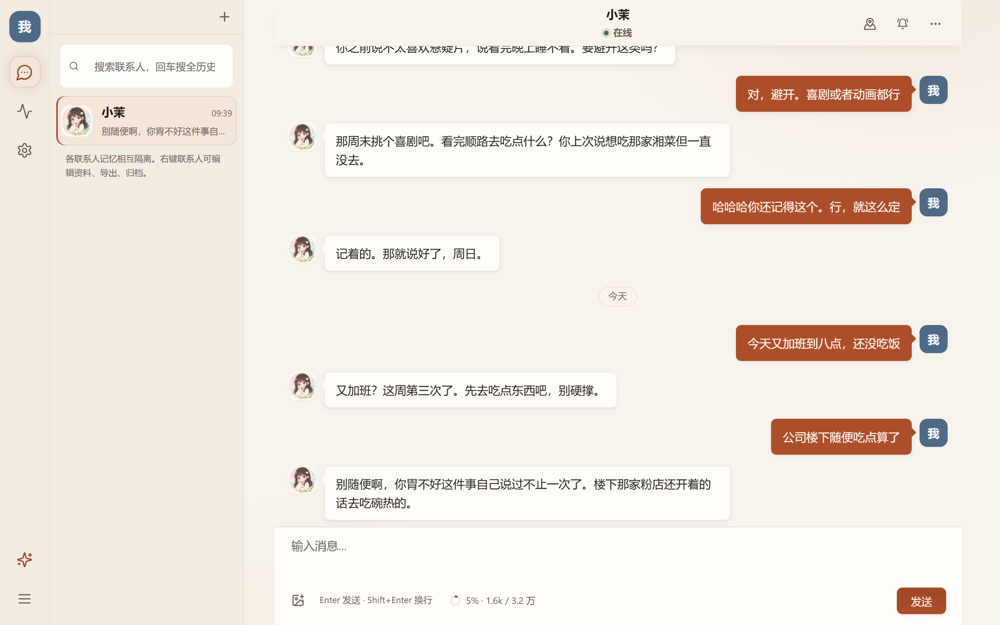
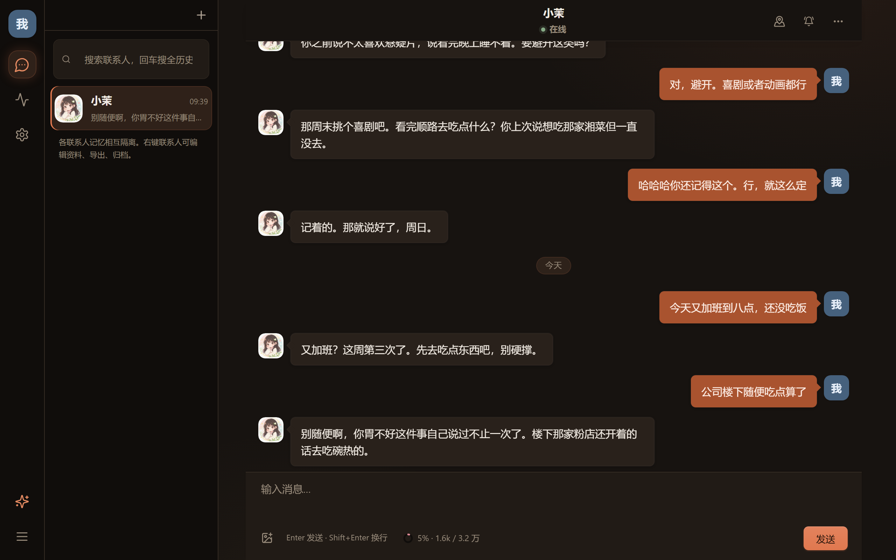
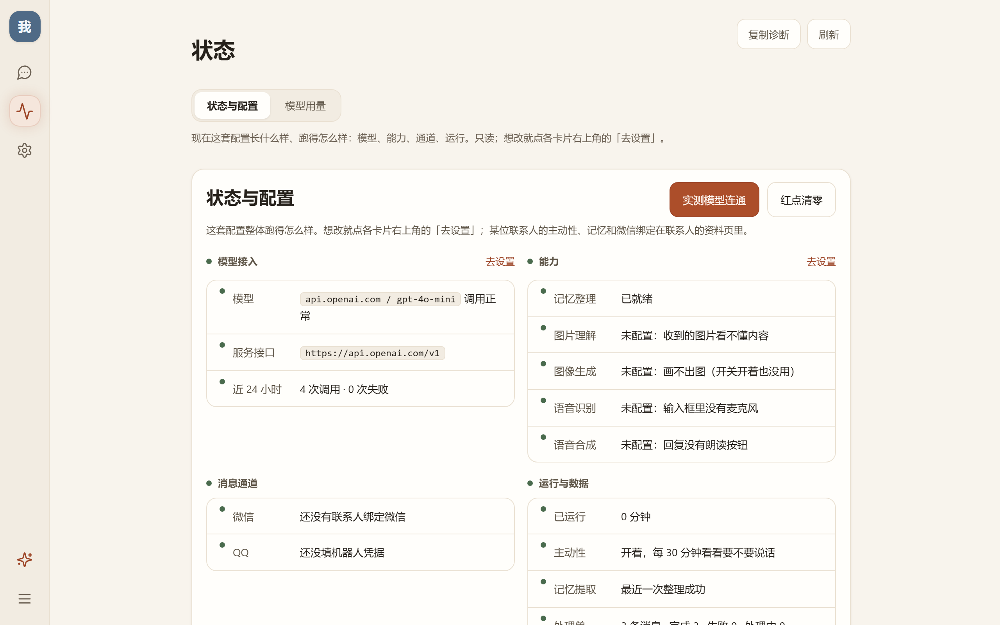
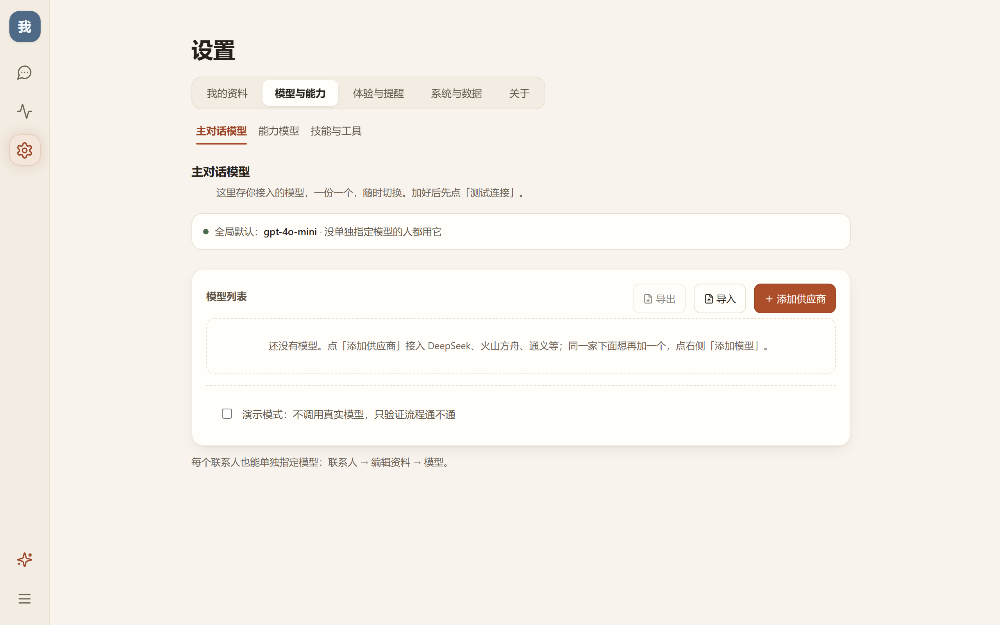
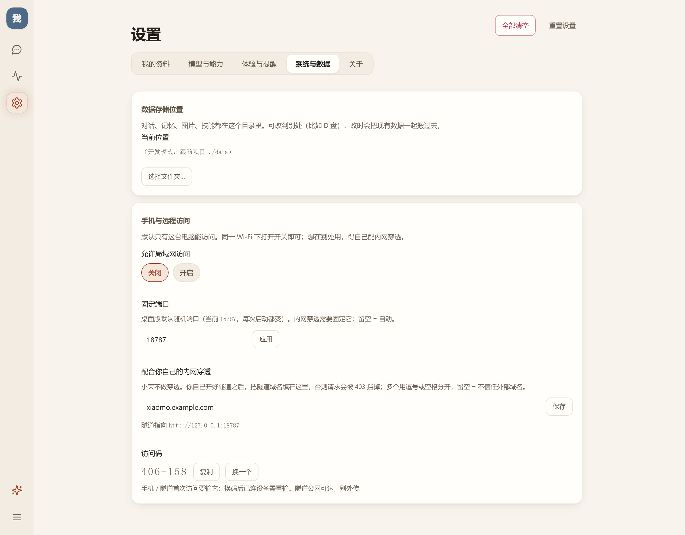

<p align="center">
  
</p>

<h1 align="center">小茉</h1>

<p align="center"><strong>记得住事，也会主动找你的陪伴型 Agent。</strong></p>

<p align="center">
  <a href="https://github.com/dmw-net/xiaomoAgent/releases/latest/download/xiaomo-latest-win-x64.exe"><b>⬇️ 下载 Windows 版</b></a>
  &nbsp;·&nbsp;
  <a href="https://github.com/dmw-net/xiaomoAgent/releases">所有版本</a>
  &nbsp;·&nbsp;
  <a href="LICENSE">Apache-2.0</a>
  <br />
  <sub>Windows 10 / 11（64 位）· 聊天记录与密钥都留在你自己机器上</sub>
</p>

<p align="center">
  
</p>

## 三步开始用

1. **下载** —— 点上面的「⬇️ 下载 Windows 版」
2. **安装** —— 双击安装包，装完打开就是上面这样
3. **接上你的模型** —— 设置 → 模型与能力 → 主对话模型，填 API 地址、密钥、模型名，点「测试连接」再保存

> 不接模型也能打开：会先用一句演示回复，让你把界面和功能试一遍。

## 小茉能做什么

小茉用你的模型说话，但**记得住你们之间发生过什么**，也会在你没主动开口的时候出现。

| | |
|---|---|
| 🧠 **长期记忆** | 把你随口提过的事记成「关系事件」。你说过胃不好、讨厌悬疑片、约好周日看电影——下次还能接得上 |
| 💬 **主动找你** | 不是随机冒泡：什么时候找你、说什么，都是一条条可查、可取消的计划。夜里不打扰、每天有上限 |
| 🕰️ **到点提醒** | 一句「明晚九点提醒我吃药」，到点原样发给你 |
| 🎭 **每位都不同** | 每位联系人有独立的人设、相处设定、记忆与语气，互不串味 |
| 🗣️ **能听能说** | 语音输入、回复朗读、图片理解（配好对应能力模型即可） |
| 🎨 **会画画** | 聊着聊着给你画一张；画好的都收在资料页的「作品」里 |
| 📱 **手机也能用** | 同一个 Wi-Fi 下用手机浏览器打开即可；想在外面用要自己配穿透（见「手机与远程访问」） |
| 🔒 **数据在你手里** | 聊天记录、记忆、密钥都存本机，不上传第三方 |

## 看看界面

### 对话

左边功能栏、中间联系人、右边对话。消息可以复制 / 编辑 / 撤回 / 删除；回复按句分成一个个气泡出现，中间调用了什么工具也会如实显示。

<p align="center">
  
  <br />
  <sub>深色主题</sub>
</p>

### 状态

一眼看清现在跑得怎么样：模型接得通不通、各项能力配没配、消息通道连没连、今天的用量与最近失败的调用。

<p align="center">
  
</p>

### 设置

五个分区：我的资料 / 模型与能力 / 体验与提醒 / 系统与数据 / 关于。主对话模型和每一项能力（图片理解、图像生成、语音识别、语音合成、记忆整理）都能各自接一个模型。

<p align="center">
  
</p>

## 手机与远程访问

默认全部关闭，只有这台电脑能访问。要用的时候在「设置 → 系统与数据 → 手机与远程访问」里打开。局域网二维码会把访问码一起带过去，扫码后自动填好，点「进入」即可；隧道访问仍需在手机上输入六位访问码：

<p align="center">
  
</p>

### 同一个 Wi-Fi

打开「允许局域网访问」，用手机扫那张二维码就行；访问码会自动填好，点「进入」即可。首次打开如果 Windows 弹防火墙提示，选「允许访问」。二维码等同于访问码，别截图外传。

### 在外面用（穿透要你自己做）

小茉**不提供穿透服务**，它只做两件配合的事：固定端口、放行你的隧道域名。

1. **固定端口**：填一个端口（比如 `18787`）并重启应用 —— 默认是系统随机端口，每次启动都不一样，隧道没法指向它
2. **自己开一条隧道**（自建或第三方服务都行），指向 `http://127.0.0.1:18787`
3. **把隧道给的公网域名填进「配合你自己的内网穿透」那一栏**，否则请求会被 403 挡掉

隧道是**公网可达**的，所以访问码是唯一的门——别把它发给别人，也别把隧道域名到处贴。域名如果每次都变，那每次都要重新填。

## 常见问题

**一定要自己准备模型吗？**
是的，小茉本身不提供模型，你用自己的 API Key（任何 OpenAI 兼容的服务都行）。好处是数据只经过你自己选的服务商。

**支持哪些模型？**
任何兼容 OpenAI 接口的服务：OpenAI、DeepSeek、通义、智谱、火山方舟、本地 Ollama 等。设置里点「测试连接」会列出该服务商可用的模型名。

**我的聊天记录会被上传吗？**
不会。聊天记录、记忆、媒体都保存在你电脑上的 `data/` 目录里，只有调用模型时把当前对话发给你配置的服务商。

**能在哪些系统上用？**
桌面版是 Windows 10 / 11（64 位）。手机或平板用浏览器打开同一份数据即可——怎么开见上一节。

**会自己更新吗？**
不会自动装。桌面版在「关于」里点「检查更新」才去查；查到新版本会让你确认，点「立即更新」才开始下载安装——不点它就一直不动。

**装完打不开 / 提示文件被修改？**
安装包对自身资源做完整性校验。如果你自己动过安装目录里的文件，或被杀软清理过，可以在 `%APPDATA%\app.xiaomo.ai` 里放一个**名为 `allow-unsigned` 的空文件**跳过校验（删掉即恢复严格检查）。

注意：**文件名就是这个，不带任何扩展名**——建成了 `allow-unsigned.txt` 不会生效（资源管理器默认隐藏扩展名，很容易建错）。PowerShell 一行最稳：

```powershell
New-Item -ItemType File "$env:APPDATA\app.xiaomo.ai\allow-unsigned" -Force
```

## 反馈与建议

- 遇到问题、想要新功能：<https://github.com/dmw-net/xiaomoAgent/issues>
- 作者：<https://github.com/dmw-net>

如果小茉帮到了你，**点个 Star ⭐ 就是最好的支持**——也方便更多人发现它。

<p align="center">
  <a href="https://github.com/dmw-net/xiaomoAgent/stargazers">⭐ 点个 Star</a>
</p>

---

<details>
<summary><b>开发者：从源码跑起来</b></summary>

### 环境要求

- **Node.js ≥ 22.18**（用到 `node:sqlite` 与原生 TypeScript 类型擦除，后端脚本一律带 `--experimental-sqlite`）
- 桌面开发 / 打包额外需要：**Rust 工具链** + **Tauri CLI**（`cargo install tauri-cli --version "^2"`）

### 快速开始

```bash
npm install
npm --prefix frontend install
cp .env.example .env        # Windows: Copy-Item .env.example .env
npm run dev                 # 打开 http://127.0.0.1:8787
```

默认 `MODEL_MODE=echo`：本地假回复，不花钱、不依赖网络，用来先把界面与记忆链路跑通。真实模型既可以在设置页配，也可以写进 `.env`（`MODEL_BASE_URL` / `MODEL_API_KEY` / `MODEL_NAME`）；设置页里配的优先。

### 目录结构

```
src/            后端：Agent 循环、记忆、主动性、通道、设置（零依赖 TS）
frontend/       前端：Vite + React + TS
shared/         前后端共用的类型定义
src-tauri/      Tauri 2 桌面外壳（Rust）
scripts/        构建、打包、校验与冒烟测试
data/           运行时数据（聊天记录 / 记忆 / 媒体 / 密钥），不入库
```

### 常用命令

| 命令 | 作用 |
| --- | --- |
| `npm run dev` | 浏览器里跑，改后端自动重启 |
| `npm run app` | 桌面窗口里跑（Tauri），前端热更新 |
| `npm run check` | 类型检查（后端 + 前端） |
| `npm run doctor` | 环境与配置自检，会列出服务商可用模型并逐个实测 |
| `npm run smoke` | 全链路冒烟（离线 echo 模式，780+ 断言） |
| `npm run pack` | 本地打 Windows 安装包（自动找签名私钥与口令） |
| `npm run desktop:build` | 同上，但签名材料要自己用环境变量给 |
| `npm run release` | 出包 + 发 GitHub Release（含 `latest.json`，应用内「检查更新」用它） |
| `npm run ver` | 版本号唯一入口：查看/校验，`npm run ver patch` 递增 |
| `npm run help` | 列出上面这些 |

### 签名密钥（出包必需）

出包需要一把 minisign 私钥 + 它的口令，**本地出包也要**——它管两件事：

| 签什么 | 谁验 | 挡住什么 |
| --- | --- | --- |
| 资源清单 `manifest.json.sig` | 应用每次启动，用**烧在 exe 里的公钥**（`build.rs` 从 `tauri.conf.json` 的 `plugins.updater.pubkey` 现读后编译进去） | 有人解开安装包、换掉 `backend/**` 再重新分发：验签不过或哈希对不上就拒绝启动，安装目录里多出来的文件也算异常 |
| 更新包 `*.nsis.zip.sig` | 客户端下载更新时，用 `tauri.conf.json` 里那把公钥 | 更新在传输链路上被替换 |

两处用的是**同一把密钥**——`build.rs` 的注释写着：手抄两份只会漂。

**口令的作用**：私钥文件本身是加密存的（minisign 的 `rsign encrypted secret key`），口令用来解它。所以光拷走 `.key` 文件签不出任何东西。

**怎么准备**（`npm run pack` 与 `npm run release` 按这个顺序找，找不到就立刻报错说清缺什么，不会白跑一趟构建）：

1. 环境变量 `TAURI_SIGNING_PRIVATE_KEY`（私钥内容）与 `TAURI_SIGNING_PRIVATE_KEY_PASSWORD`
2. 或 `%USERPROFILE%\.tauri\xiaomo-updater.key` 与同目录的 `xiaomo-updater.pass`

**换钥匙或丢钥匙的后果**：公钥已经烧进每一个发出去的 exe，所以两种情况的结局一样——**老用户更新断链，只能手动重装**。这把钥匙值得额外离线备份一份。

**它不防什么**（别过度信任）：不解 Windows SmartScreen 的「未知发布者」（那要买 Authenticode 证书）；防不住拿到本地 exe 后把校验 patch 掉的人；也不保护打包后的 JS 不被逆向——那层编码只是把门槛从「一条命令」抬到「得逆向」。

### 安全须知

- **所有 `/api/*` 都没有鉴权**。默认只监听 `127.0.0.1`；直接暴露到公网等于公开聊天记录。需要公网访问请自己加鉴权，或只在可信隧道之后使用（隧道域名要写进白名单，否则会被主机守卫 403）
- **外链预览会出网**：消息里出现 http(s) 链接时，链接卡在进入视口后会由本机向该站点抓取标题/描述/favicon（只读公开网页，走同一套地址校验与大小上限）。对方站点因此能看到你的 IP；不想让某条链接被访问，把它放在行内代码或代码块里即可。
- `DEV_MODE=1` 会把模型请求原文（含系统提示词）暴露给界面，只用于本地排查
- **访问码门覆盖局域网与隧道**：免码的唯一情形是「从本机发起 **且** 访问的是本机地址」，所以局域网手机和隧道访客都要先输码（实现见 `src/lan.ts`；隧道虽从本机出去，但 Host 是公网域名，一样要码）。这道门不能省：`/api/settings` 会把模型密钥原文回给调用方，那是「本机应用」的前提
- 打包时提示词等中文资产会做编码处理，安装包里的后端是压缩单文件；密钥文件 `dist-desktop/asset-key.txt` 不入库
- 安装后的资源会被运行期校验（签名 + 逐文件哈希 + 反向比对，见上一节）：动过安装目录里的文件，应用会拒绝启动并说明是哪个文件。误删或杀软隔离时，可在 `%APPDATA%\app.xiaomo.ai` 放一个名为 `allow-unsigned`（**不带扩展名**）的空文件跳过本次校验（删掉即恢复严格模式）

</details>

## 许可证

[Apache License 2.0](LICENSE) · Copyright 2026 dmw-net

源码仓库：<https://github.com/dmw-net/xiaomoAgent>